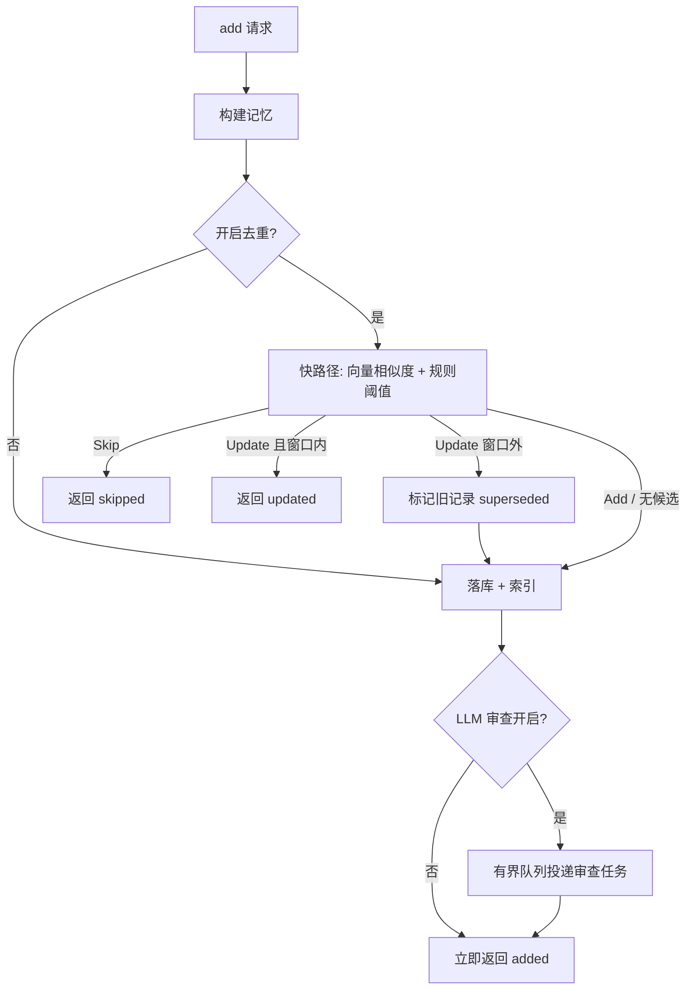

# 写入快慢路径拆分与检索指标

> 落地日期：2026-11-10
> 前置：`docs/design/injection-budget-design.md`（注入预算与访问反馈）

## 1. 背景

上一轮解决了“读侧预算化”和“访问反馈”，本轮处理两项遗留：

1. `add` 的写入路径只有同步规则去重，不具备语义级冲突判断（重复/矛盾/过时）；
   若把 LLM 判断塞进请求链路，写入延迟与可用性都会被外部模型绑架。
2. 检索侧只有 Dream 审计与评测门禁，缺少运行时指标，无法回答“注入是否经常为空”、
   “预算是否经常不够”、“去重是否在起作用”。

## 2. 写入快慢路径



### 2.1 快路径（同步，始终启用）

规则版 `RuleDedupDecider`：向量 top-k + 阈值，无外部依赖。保证 `add` 的延迟只包含
一次嵌入与一次近邻检索。

### 2.2 慢路径（周期批量，默认关闭）

后台任务按 cron 周期批量执行：选取窗口内的新增记忆 → 回表取候选全文 → LLM 判断 → 落地动作。
默认 `0 4 * * 6`（周六 04:00），错过窗口不补跑；单轮上限 `llm_review_max_per_run`
（普通数值，设为超大值即全量，0 表示本轮不处理），超出部分直接丢弃。

| 结论 | 落地动作 | 可逆性 |
|------|----------|--------|
| `keep` | 不修改 | — |
| `supersede_new` | 新记忆加 `superseded_by` 标签与 metadata 后软删 | `restore` 可恢复 |
| `supersede_old` | 旧记忆加 `superseded` 标签与 `superseded_by`（不软删、不改正文） | 可人工撤销标签 |

安全约束：

- 只做标记/软删，不覆盖正文；
- 模型输出的 `target_id` 必须来自候选集，否则降级为 `keep`；
- 解析失败、LLM 异常、存储异常一律按失败计数，不产生破坏性动作；
- 单轮条数有上限，超出部分丢弃并计数，不滚入下一轮；
- 分块写入（`part:` 标签）跳过，避免逐块调用 LLM；
- 与 Dream 分工：本机制只处理“单条新记忆 vs 既有记忆”，跨簇整合仍归 Dream。

候选阈值支持三种口径：

| 口径 | 判定 |
|------|------|
| `absolute` | `score >= llm_review_min_score` |
| `ratio` | `score >= best_score × llm_review_score_ratio` |
| `hybrid` | `score >= max(llm_review_min_score, best_score × llm_review_score_ratio)` |

### 2.3 配置

```toml
[dedup]
llm_review_enabled = false          # 默认关闭，需同时配置 [llm]
llm_review_cron = "0 4 * * 6"       # 周六 04:00（本地时间）
llm_review_max_per_run = 50         # 单轮上限；9999999 即全量；0 = 本轮不处理
llm_review_max_candidates = 5       # 送审候选上限
llm_review_threshold_mode = "absolute"
llm_review_min_score = 0.7
llm_review_score_ratio = 0.9
```

## 3. 检索侧指标

计数器为进程内原子量，`stats` 读取快照并换算比率。指标不落盘、不参与任何决策。

| 字段 | 含义 |
|------|------|
| `search_requests` | 检索请求总数（普通 + 分层） |
| `budget_requests` / `budget_empty` | 分层请求数 / 其中返回空结果数 |
| `budget_overflow` | 候选数大于保留数（预算不足导致丢弃）的请求数 |
| `results_full/truncated/summary/dense_proxy` | 分层结果层级分布 |
| `dedup_checked/skipped/updated/added` | 去重决策分布 |
| `review_runs` | 已完成的审查轮数 |
| `review_queued/skipped` | 累计送审条数 / 因单轮上限丢弃条数 |
| `review_keep/supersede_old/supersede_new/failed` | 审查结论分布 |
| `review_last_run_at` | 最近一次审查完成时间 |
| `empty_injection_rate` | `budget_empty / budget_requests` |
| `budget_overflow_rate` | `budget_overflow / budget_requests` |
| `downgrade_rate` | 非 Full 结果数 / 结果总数 |
| `dedup_hit_rate` | `(skipped + updated) / dedup_checked` |

口径说明：

- 比率为 0 表示“无样本”或“未命中”，两者在观测上等价；
- `dedup_updated` 按决策计数：窗口外 Update 最终回退为新增时仍计入 update；
- 重启清零，适合观察当前运行状态；跨重启趋势应使用 DreamRun 审计与评测数据。

## 4. 退出条件与验证

| 编号 | 退出条件 | 结果 |
|---|---|---|
| E1 | `cargo build --release` / `cargo test --release --workspace` 通过 | 通过 |
| E2 | 审查解析与落地动作单测覆盖（keep/supersede_new/supersede_old/非法输出/目标越界） | 6 用例通过 |
| E3 | 指标快照与比率、cron 解析/下次时刻、阈值口径、单轮上限单测 | 通过（cron 7 例、review 6 例、metrics 4 例） |
| E4 | 运行时按 cron 触发，单轮上限与 `review_skipped`、状态文件生效 | 通过：`*/2` 验证于 13:54 触发；selected=1 / skipped=168 / keep=1；`review.state` 已落盘 |
| E5 | `stats` 输出包含检索指标且各项自洽 | 通过：budget=1、overflow=1.0、downgrade=1.0、层级分布 3 summary + 2 proxy |
| E6 | `scripts/retrieval_gate.sh` 退出码 0 | 通过 |
| E7 | 两处目录部署、服务正常 | 通过：备份 `~/.memrec.bak.20261110_132409`，两处目录已更新 |
| E8 | 约定式提交（不推送） | 见提交记录 |

## 5. 已知限制

- 审查按周期串行执行，单轮超出上限的记忆直接丢弃（已计入 `review_skipped`）。
- 审查使用与写入侧相同的嵌入模型；模型升级后历史向量的相似度口径可能与新写入不一致。
- `supersede_old` 不软删旧记忆，旧记忆仍可被检索命中（带 `superseded` 标签），
  是否降权由后续检索策略决定。
- 指标为进程内计数，多实例部署时各自独立。
