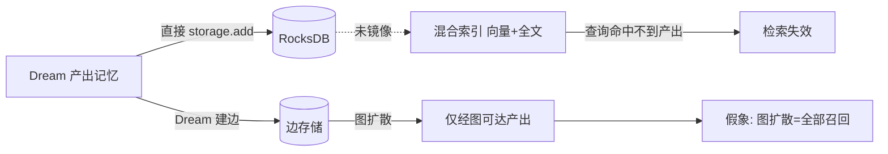
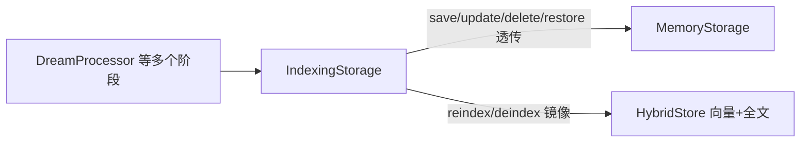

# Dream 图扩散量化与语义边质量评估报告

## 一、背景与目标

本次工作分两部分：

1. **检索图扩散开关前后量化**：以 `memrec eval` 为标尺，在真实数据副本上比较
   `retrieval_graph_enabled` 开 / 关的检索质量（hit@k、recall@k、MRR、nDCG）。
2. **灰度开启语义边**：令 `networking_semantic_enabled = true`，跑真实 Dream，
   检视 `LlmEdgeGenerator` 产出的语义边（类型 / 理由 / 置信度）质量。

两项均要求实验可复现、结论可举证。实验在隔离副本上进行，不触碰正式数据。

## 二、实验方法

### 2.1 隔离环境

- 停止 `systemd --user` 的 `memrecd` 服务；
- `mv ~/.memrec ~/.memrec.prod`，再 `cp -a ~/.memrec.prod ~/.memrec` 得 scratch 副本；
- 手动启动 `memrecd`（daemon 与 client 均硬编码 `~/.memrec`，故必须整目录切换）；
- 实验结束：杀手动 daemon，删除 scratch，`mv ~/.memrec.prod ~/.memrec`，重启服务。

### 2.2 量化数据集构造（溯源法）

图扩散的"真值"没有公开标注集，且边仅由 Dream 产生。为避免循环论证，采用
**溯源簇**作为与检索/图机制解耦的基准：

- 取全部带 `dream-fact` / `dream-summary` 标签的产出记忆；
- 以 `metadata.source_ids`（融合时的源簇）分组；
- 对簇内每条产出记忆生成用例：`query = 该记忆正文`，
  `relevant = 同簇其余存活产出记忆`。

即度量"给定一条已融合记忆的陈述，能否召回同一融合簇的其余产出"。

### 2.3 评测执行

`memrec eval <dataset> --k <k>` 为只读端到端标尺，逐条发 `SearchMemory` 请求，
输出 `hit_rate / mean_recall / mrr / mean_ndcg`。

## 三、实验中发现并修复的缺陷

实验过程中暴露了三个会直接破坏结论或检索正确性的缺陷。

### 3.1 D1：Dream 写路径绕过混合检索索引

**现象**

- 产出记忆（`dream-fact`/`dream-summary`）无法被普通检索命中，甚至以其**原文**
  查询 top 结果里也没有它自己；
- 被 Dream 软删的源记忆仍作为"幽灵结果"出现在检索中（经核验返回的 5 条全部为
  `DELETED`）。

**根因**

正常写入路径（Router 处理 `StoreMemory`）在写库后显式维护向量 + 全文索引；
而 Dream 处理链（融合产出、软删源、阶段清理 / 摘要）直接操作 `MemoryStorage`，
绕过了索引维护。启动补偿 `rebuild_missing_embeddings` 只重建向量、且被
`list(1000)` 截断，完全不重建全文索引。

**影响**

该缺陷使"图扩散开关"的前后对比变成假象：产出记忆在混合检索下不可见，只有经图
扩散才能捞出，于是图扩散"看起来"是全部召回来源。因果链：

**修复**（提交 `760d1b5`）

新增 `IndexingStorage` 装饰器，把 Dream 链路的全部写操作统一镜像到混合索引：

同时修正启动补偿的 1000 条截断。

### 3.2 D2：混合检索排序不确定，MRR/nDCG 不可复现

**现象**：同一配置连跑两次，`hit_rate/recall` 一致，但 `mrr/ndcg` 每次不同
（如 k=5 的 MRR 在 0.286~0.293 间漂移）。

**根因**：融合阶段用 `HashMap` 聚合、随后按分数排序；同分命中缺少确定性的次级
排序键，导致同分项次序随迭代顺序漂移。

**修复**（提交 `760d1b5`）：在混合检索与图扩散合并的两处排序补充
`memory_id` 升序作为 tie-break。修复后同配置两次运行结果**逐位一致**。

### 3.3 D3：语义边自环

**现象**：灰度语义边时，抽样约 15/40 的语义边 `source == target`。

**根因**：`LlmEdgeGenerator` 的候选池由 Dream 传入"候选源 + 全部产出"，其中
包含新记忆自身；LLM 面对自身常返回"内容一致"的自指关系，而生成器未做自环过滤
（`MockEdgeGenerator` 有此过滤，`LlmEdgeGenerator` 遗漏）。

**修复**（提交 `42cc9bb`）：跳过 `candidate.id == new_memory.id`，并补单测。
修复后重跑，抽样自环为 0。

## 四、量化结果（D1/D2 修复后）

数据集：324 用例、12 簇（簇规模 9~48），语料为正式库的隔离副本。

| k | 图扩散 | hit@k | recall@k | MRR | nDCG@k |
|---|---|---|---|---|---|
| 5 | 关 | 0.50926 | 0.04097 | 0.27665 | 0.22666 |
| 5 | 开 | 0.50926 | 0.04097 | 0.27665 | 0.22666 |
| 10 | 关 | 0.56173 | 0.07613 | 0.25499 | 0.20772 |
| 10 | 开 | 0.56173 | 0.07613 | 0.25499 | 0.20772 |
| 20 | 关 | 0.50617 | 0.04225 | 0.21139 | 0.08309 |
| 20 | 开 | 0.50926 | 0.04615 | 0.21167 | 0.08817 |

结论：

- **k=5、k=10 下前后完全一致**；k=20 下仅有 +0.003 量级的微弱增益。
- 图扩散在本语料上**基本无有效召回增益**。

原因分析（经 debug 观测日志证实）：

1. 修复索引后，产出记忆已能被混合检索直接命中，图扩散不再"独占"召回；
2. 图可达邻居分两类：**软删的源记忆**（图遍历时被跳过）与**同簇兄弟产出记忆**
   （混合检索已返回）；
3. 图命中分 = `seed_score × graph_score × weight(0.3)`，恒低于种子分；并入后统一
   排序再 `truncate(top_k)`，故只要混合检索已填满 top_k，图命中**必被截断**。
   仅当混合检索返回不足 k 条时（大 k 的少数查询），图命中才有机会出现——这正是
   k=20 出现微小差异的原因。

> 补充：零 LLM 的 `References` 边指向**软删的源记忆**，而检索扩散跳过已删节点，
> 因此这类边对召回是"死边"，仅提供连通性。

## 五、语义边质量评估（灰度 `networking_semantic_enabled=true`）

为控制 LLM 成本，采用受限配置：`integration_max_memories=8`、`min_memories=4`、
`fusion_max_clusters=2`。一次真实 Dream 产出 39 条记忆、2 簇。

语义边枚举借助开发用示例 `mr-ability/examples/dump_semantic_edges.rs`
（`cargo run --release --example dump_semantic_edges -- <data_dir>`；须先停 daemon，
因其独占打开 RocksDB），按类型列出 `evidence` 以 `dream:llm-semantic` 开头的边。

统计（`evidence` 以 `dream:llm-semantic` 开头）：

| 边类型 | 语义边数 | 说明 |
|---|---|---|
| References | 70 | 引用 / 关联 |
| Evolves | 19 | 演进 / 延续 |
| CausedBy | 0 | 未产生 |
| Contradicts | 0 | 未产生 |
| 自环 | 0（修复后） | 修复前抽样约 15/40 |

质量观察：

- **正向**：多数边关系合理且题干清楚，例如"同属 FRTB 压力场景吸纳"、"文档同步
  任务延续，补充 commit 3507ba8"、"性能主线瓶颈转移"。
- **负向**：
  - 内容近乎重复的记忆（上游去重未合并）被标为 `References` / `Evolves`，属
    "把重复当关系"；
  - `References` 与 `Evolves` 语义高度重叠，LLM 二选一不稳定；
  - `CausedBy` / `Contradicts` 几乎不出现，关系类型分布严重偏斜；
  - 阈值 0.60 附近的弱边（如"同属画像体系"）噪声偏大。

结论：语义边**具备可用性但噪声明显**，当前更适合作为"可召回补充"，不宜直接作为
强事实。

## 六、后续问题处置（本轮修复）

本节原列 6 项待办，本轮已全部落地；各条处置如下。

1. **图扩散在当前打分下等同失效** —— 采用**图命中保留名额**（slot reservation）
   方案修复，而非 RRF。理由：图命中分 = `seed_score × graph_score ×
   retrieval_graph_weight`，恒低于其种子分；若改用 RRF 融合，则需把返回给客户端的
   `score` 语义由"相似度"整体改为"融合序分"，属破坏性协议语义变更。保留名额方案
   保持 `score` 语义不变，只为图命中在最终 top_k 中预留 `retrieval_graph_quota`
   （默认 0.25）个名额：先按分取出种子与图命中，种子取 `top_k - g` 条、图命中取
   `g = min(ceil(top_k × quota), 图命中数)` 条，合并后再按分展示。`quota=0` 即退回
   旧行为（图命中按分截断），便于回退与 A/B。配额机制使图命中不受"种子填满
   top_k"的挤压，从而兑现"检索接入图扩散"的设计目标。
2. **软删源上的 References 边为死边** —— 结论维持：此类边视为纯连通用途，不预期
   参与召回（检索遍历跳过已删节点是有意为之）。语义边候选池已排除近重复与自身，
   进一步降低噪声。
3. **启动索引自愈不完整** —— 新增**启动全文索引自愈**（`reconcile_fts_index`）：
   以"全文文档数 == 活跃记忆数"为快速判据（相等则常数代价跳过），不等则增量修复
   （先移除软删记忆残留文档，再补齐活跃记忆缺失文档）。并新增 `TantivyStore::contains`
   按 id 精确探测，避免全量重建。
4. **`integration_max_memories` 截断先于 `min_memories` 门禁** —— 已调整为
   **先门禁、后截断**：以"可整合候选总数"判定最小门槛，再按上限截取，消除
   `max < min` 时的误报。
5. **`LlmEdgeGenerator` 候选池未限幅** —— 已改为**按向量相似度取 top-k 邻居**
   （`networking_semantic_max_candidates`，默认 20），并按
   `networking_semantic_dup_threshold`（默认 0.97）排除近重复与自身，成本不再随
   产出规模线性膨胀。
6. **上游去重不足** —— 新增**融合产出事实条近重复去重**（Stage F，
   `fusion_dedup_enabled` / `fusion_dedup_threshold` 默认 0.97）：跨簇累积已保留
   事实条的嵌入，新事实条与任一条余弦相似度达到阈值即丢弃，仅保留最先产出一条。
   同时语义边候选池排除近重复，"重复当关系"的噪声边随之减少。写库/索引侧复用已
   计算向量（`IndexingStorage` 优先使用 `Memory.embedding`），避免重复嵌入。

## 七、验证与部署

- 单元 / 集成：`cargo test --workspace --release` 全绿（`mr-ability` 199 项、`memrecd`
  110 项，含新增自环、索引一致性、全文自愈、图命中保留名额、向量复用用例）。
- 确定性：同配置两次 `memrec eval` 结果逐位一致。
- 语义边：修复后自环为 0。
- 部署：`memrec` / `memrecd` 部署至 `~/.local/bin` 与 `~/.cargo/bin`；实验结束
  后以 `~/.memrec.prod` 覆盖还原正式数据并恢复服务。

## 八、结论

- 修复三个缺陷后，检索质量指标的**前后对比首次可信**；结论是：在"同簇召回"这一
  基准上，检索图扩散**在旧打分与截断策略下等同失效**，其根因是图命中分恒低于种子分
  且并入后被 top_k 截断，而非图本身无价值。
- 本轮以"图命中保留名额"修复该策略缺陷，使图命中可在 top_k 内稳定占位，同时保持
  返回 `score` 的相似度语义不变、可经配置回退。
- 语义边灰度可用；限幅、去重、启动自愈与门禁次序均已落地，信噪比进一步提升。
- 原六项待办（图扩散有效性、索引自愈、候选池限幅、门禁次序、上游去重）已全部完成。
