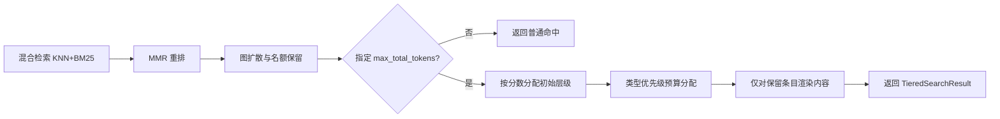
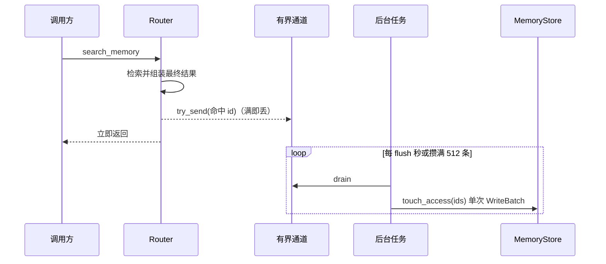

# 检索注入预算与访问反馈设计

> 落地日期：2026-11-10
> 来源：得物 MultiAgent 记忆系统中“按生命周期分层、按预算注入、读写分离”的工程实践，经裁剪后适配 memrec 单机守护进程形态。

## 1. 背景与取舍

原文的四层记忆模型（Working/Session/User/Agent）与 Redis+MySQL 双写不适用于 memrec：working/session 属于宿主（DSH）的上下文与日志，memrec 只负责长期记忆；存储为单机嵌入式 RocksDB，引入外部缓存只增加一致性负担。

真正可落地的只有三点：

1. 注入侧预算化：memrec 早已实现 `TieredEngine`，但没有接到任何调用方（`TieredSearch` 仅存在于协议层），且 token 估算按英文字符启发式计算，对中文严重低估。
2. 类型优先级：预算在类型之间平均分配，高价值用户偏好可能被高分的项目细节挤出。
3. 读路径反馈：检索不更新 `last_accessed`/`access_count`，导致重要性模型的时效与频率维度长期是常量。

## 2. 设计

### 2.1 分层表示与预算



关键约束：

- **先降级、后丢弃**：`Full → Truncated → Summary → DenseProxy`，四层都放不下才丢弃。
- **渲染与层级一致**：只在预算分配完成后渲染内容，避免旧实现“标注 Summary、实际塞全文”的预算失真。
- **超预算判定用同一口径**：分配阶段的估算与最终渲染的 `token_count` 使用同一个函数。

### 2.2 Token 估算口径

| 字符类别 | 估算 | 说明 |
|---|---|---|
| CJK（汉字/假名/韩文/全角标点） | 1 token/字 | 与主流中英文 tokenizer 接近 |
| 其他非空白字符 | 0.25 token/字符 | 英文约 4 字符/token，略保守 |
| 空白 | 0.1 token/字符 | 避免长空白占额 |

旧口径 `字符数 × 0.4` 会把中文低估约 2 倍，4000 预算实际放行近万字中文。截断函数同步改为按 token 累计，并优先在句末标点处收尾。

### 2.3 类型优先级

默认策略（可配置）：

| 顺序 | 类型 | 预算上限 | 依据 |
|---|---|---|---|
| 1 | `preference` | 50% | 跨项目复用、扇入最高 |
| 2 | `decision` | 30% | 关键决策，长期有效 |
| 3 | `knowledge` | 20% | 知识/事实 |
| 4 | 未列入类型（`context`/`conversation`） | 剩余额度 | 只在预算有余时进入 |

上限表示“最多占用”而非“预留”：某类候选不足时额度自动让给后续类型；第一遍分配后仍有剩余预算时，按分数回填被类型上限推迟的候选。

结果排序为“优先级分组内按分数降序”，保证偏好在上下文中位置更靠前。

### 2.4 访问反馈



- 请求链路不做任何写操作；
- 回写只改记忆主记录，不重建向量/全文索引；
- 同一批内去重，软删记录跳过；
- 统计可容忍丢失，通道满时直接丢弃。

## 3. 接口与配置

- 协议：`search_memory` 新增可选 `max_total_tokens`；指定后返回 `tiered_search_result`（含 `tier`/`content`/`token_count`/`memory_type`/`tags`），未指定时行为不变。
- CLI：`memrec search --max-tokens <N>`。
- MCP：`mr_search` 新增 `max_total_tokens`。
- DSH 插件：`agent/pre-step` 注入固定携带预算（`contextMaxTokens`，默认 4000），按 `content` 与 `tier` 渲染，不再硬编码 8 条上限。

```toml
[retrieval]
access_recording = true
access_flush_secs = 5
injection_max_tokens = 4000
injection_type_caps = [
  { memory_type = "preference", ratio = 0.5 },
  { memory_type = "decision",   ratio = 0.3 },
  { memory_type = "knowledge",  ratio = 0.2 },
]
```

## 4. 退出条件与验证结果

| 编号 | 退出条件 | 结果 |
|---|---|---|
| E1 | `cargo build --release` 通过 | 通过 |
| E2 | `cargo test --release --workspace` 全绿（新增 token 估算、类型预算、渲染一致性、访问回写、预算检索用例） | 通过 |
| E3 | 预算检索返回分层结果且 `total_tokens <= budget`；不指定预算时行为不变 | 150/300/1200/4000 四档均满足，无预算仍返回 `semantic_search_result` |
| E4 | 插件 `tsc` 构建与 `npm test` 全绿（含分层渲染用例） | 15/15 通过 |
| E5 | 检索后访问统计异步落库 | debug 日志确认 `access flushed: 8 memories` |
| E6 | `scripts/retrieval_gate.sh` 退出码 0 | 自检索 1.0 / hit@5 1.0 / MRR 0.898 / 负例均达标 |
| E7 | 部署两处目录并正常启动 | `~/.local/bin` 与 `~/.cargo/bin` 均已更新，服务 active |
| E8 | 约定式提交（不推送） | 见提交记录 |

## 5. 已知限制

- 独立 `TieredSearch` RPC 不经过图扩散；需要图扩散时应使用 `search_memory + max_total_tokens`（注入侧即走此路径）。
- 分层构建会再次批量回表（`get_many`），与检索侧的回表重复一次；top_k 有限时可忽略。
- 访问统计不参与排序（评分只用时间衰减与来源权重），因此不会形成“越注入越靠前”的自我强化回路。
- 检索侧仍存在历史遗留的“软删记忆残留在索引中”的现象；分层路径会按存储真实状态过滤，普通路径未改动，留待后续统一修复。
