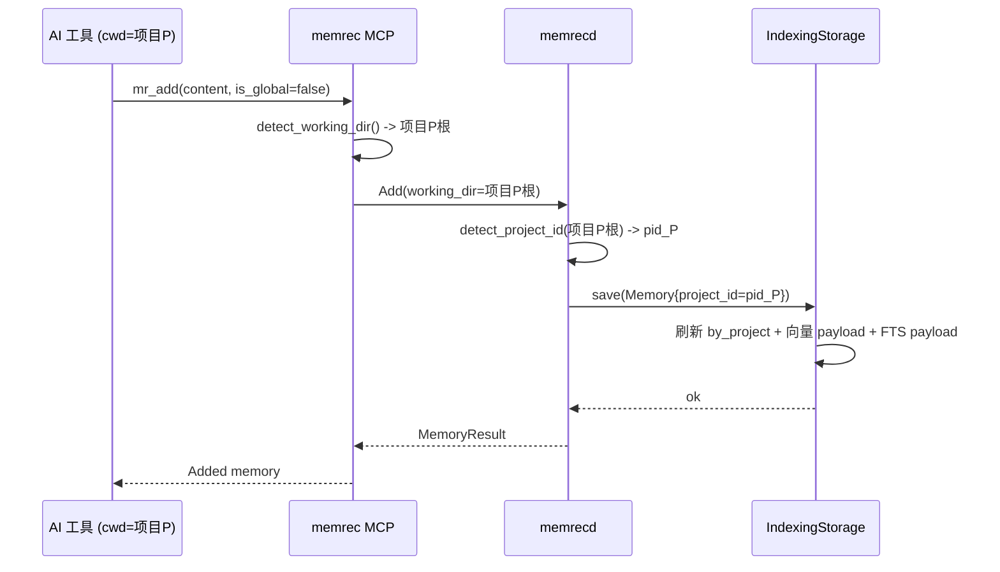
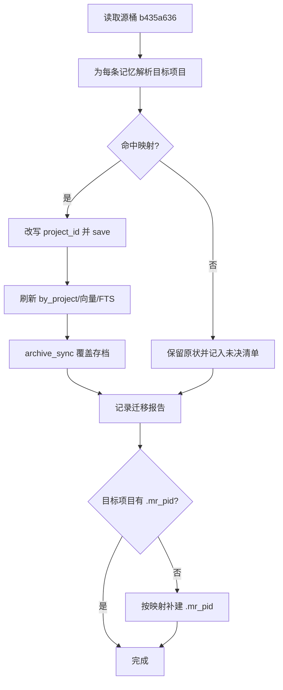

# 项目归属回迁与检索评分修正设计

> 范围：MCP 写入路由（WS1）、历史误归属数据迁移（WS2）、检索评分地板（WS3）。
> 状态：设计（待裁决）。本文不含实现代码，仅以伪代码说明关键逻辑。

## 1. 背景

一次在 `/home/helly/LinuxEnv` 项目内对 memrec 全库的检索评估暴露三类问题：

1. 写入端项目路由失效：经 MCP 写入的记忆全部落入同一项目桶（报告实测 `b435a636`，约 987/1776），桶内混杂多个不相关项目。
2. 未注册项目不可检索：`/home/helly/LinuxEnv` 无 `.mr_pid`，项目内默认范围回落全局，导致"记录得进去、项目内检索不出来"。
3. 相关记忆得分恒为 0.5：高特异查询得分恰落 0.5，区分度差，多条命中堆叠在同一分数。

本文先核查代码事实，再对三个工作流分别给出上/中/下三策，并给出实施顺序、验收与回滚。

## 2. 现状核查（代码事实）

### 2.1 写入/读取路径对照

| 入口 | 位置 | working_dir / 项目处理 | 归属正确性 |
|------|------|------------------------|-----------|
| CLI `add` | `memrec/src/main.rs:200` | 非 global 传 `detect_working_dir()` | 正确 |
| CLI `search` | `memrec/src/main.rs:295` | project 范围传 `detect_working_dir()` | 正确 |
| CLI `list` | `memrec/src/main.rs:236` | 读 `.mr_pid` 得 `project_id` | 正确 |
| MCP `mr_add` | `memrec/src/mcp/mod.rs:398` | 恒 `working_dir: None` | **错误** |
| MCP `mr_search` | `memrec/src/mcp/mod.rs:450` | project 范围传 `detect_working_dir()` | 正确 |
| MCP `mr_list` | `memrec/src/mcp/mod.rs:509` | 读 `.mr_pid` | 正确 |

结论：缺陷是单点的——**仅 MCP 写路径 `tool_add` 未传递 `working_dir`**。读路径（search/list）与 CLI 写路径均已正确对齐。

### 2.2 归属解析语义

服务端 `build_add_memory`（`memrecd/src/server/handler.rs:306`）：

```
project_id = p.project_id
             .or_else(|| detect_project_id(p.working_dir))
```

`detect_project_id(None)`（`mr-ability/src/project/detect.rs:128`）取**调用进程当前目录**。由于 Add 在守护进程 `memrecd` 内执行，`None` 等价于**守护进程启动目录**，与调用方所在项目完全无关。这正是"所有 MCP 写入汇入同一桶"的机制。

### 2.3 归属信息分布在多处（迁移必须同步的面）

一条记忆的项目归属并非只存一处，迁移必须覆盖以下全部落点：

1. `cf_memories` 中的 `Memory.project_id`——真源。
2. `cf_by_project` 二级索引（key = 桶 16B + id 16B）——由 `MemoryStore::save` 自动维护（`memory_store.rs:142-165`）。
3. 向量索引 `VectorPayload.project_id`（RocksDBVectorStore）——由 `IndexingStorage::reindex` 维护（`indexing.rs:67-126`）。
4. 全文索引 payload 的 `project_id` 字段（Tantivy）——同上。
5. 存档 SQLite `raw_inputs.project_id`——由 `archive_sync` 维护（`archive/sqlite.rs:64`），与主库解耦。

已知残留（`MEMORY.md`）：向量/FTS payload 快照内的 `pid` 存在历史残留，过滤侧当前以等价容忍；迁移应顺带归一。

### 2.4 评分链路

`HybridStore::search`（`hybrid_store.rs:169`）与 `merge_and_normalize`（`:76`）：

1. 向量侧原始 score = 余弦相似度；先在 `RocksDBVectorStore` 按 `filter.min_score` 过滤（`rocksdb_vector.rs:211`）。
2. `merge_and_normalize`：分别对向量集、FTS 集做 min-max 归一化到 `[0,1]`；向量侧乘 `alpha`，FTS 侧乘 `(1-alpha)`，同 id 相加。
3. 融合结果再按 `filter.min_score` 截断（`hybrid_store.rs:200`）。

由此产生的后果：

- 纯向量命中的**顶项融合分恒等于 `alpha`**（默认 0.5）。
- 默认 `min_score = 0.5`（`mr-protocol/src/request.rs:352`）恰好等于该顶项分：顶项被保留，其余被截断。表现即"分数钉在 0.5"。
- 同一个 `min_score` 同时作用于"原始余弦"与"融合分"，属**量纲混用**；`alpha` 一旦被调，地板随之漂移。

## 3. 根因

- **R1 写路由**：MCP `tool_add` 不传 `working_dir` ⇒ 归属取自服务进程 cwd。
- **R2 未注册**：项目缺 `.mr_pid` ⇒ 读默认范围回落 `Global`，项目内检索为空。
- **R3 评分**：min-max 归一化使融合分依赖候选集分布；融合分与原始相似度共用同一 `min_score` 阈值，且默认阈值等于 `alpha`，形成地板。

## 4. 设计目标与非功能约束

- 写路由：任何入口（CLI/MCP）写入的归属只由"调用方所在项目"决定；无项目时落全局。
- 迁移：既有误归属记忆按项目回迁；幂等、可回滚、可审计、不丢失向量（避免全量重嵌入）。
- 评分：`min_score` 语义单一、量纲一致，消除 0.5 地板；保持自检索不变量与金标门禁通过。
- 非功能：日志可观测（迁移计数/归属变更）、备份可回滚、迁移尽量复用既有向量。

## 5. 方案

### WS1 写路由修复

**上策（推荐）**：`tool_add` 对齐 `tool_search`——非 global 时传 `detect_working_dir()`；补一条"写路径归属一致性"单测（构造临时项目目录，验证写入落到该项目 UUID）。

伪代码：

```
tool_add:
  working_dir = if is_global { None } else { detect_working_dir() }
  AddParams { project_id: None, is_global, working_dir, ... }
```

**中策**：仅改服务端——Add 在 `working_dir` 缺失时不再回落进程 cwd，一律视为全局。风险：改变既有语义，且影响所有未注册项目的 CLI 写入。

**下策**：不改代码，以文档约束调用方显式传 `project_id`。不推荐（依赖调用方自律，且 MCP 未暴露该参数）。

### WS2 历史数据迁移

**关键难点**：目标项目 UUID 的来源。项目 UUID 仅存于各项目根的 `.mr_pid`，系统**没有中心化项目注册表**。

映射来源候选：

- A. **磁盘发现**：扫描文件系统中的 `.mr_pid`（`plocate`/`fd`），建立 `项目名 → UUID` 映射；再据记忆的标签/内容/元数据匹配项目名。
- B. **显式映射文件**：用户提供 `(匹配规则 → 项目根)` 清单，最精确但需人工。
- C. **标签即项目名**：误归属桶内大量记忆带项目名标签（报告中的 `qes3`/`varhighscale`/`speedboat` 等），以标签为准定位项目。

设计为独立命令，分两段（只读预演 + 显式执行）：

- `dry-run`：扫描源桶，按映射规则给出建议目标项目清单与计数，输出表格/JSON，不写库。
- `apply`：逐条经 `IndexingStorage::save` 改写 `project_id`（一次调用同时刷新 `by_project`、向量 payload、FTS payload），随后 `archive_sync` 覆盖存档，并输出迁移报告。

幂等条件：仅当"记忆当前桶 == 源桶"时改写；重复执行无副作用。

同时补建缺失的 `.mr_pid`：迁移若命中"某项目名有记忆但磁盘无 `.mr_pid`"，按映射生成并写入该项目根的 `.mr_pid`，使后续读写归位。

伪代码：

```
migrate(source_bucket, mapping):
  for m in list_by_project(source_bucket):
    target = resolve(m, mapping)          # 标签优先，其次内容/元数据
    if target and target != source_bucket:
      m2 = m with project_id = target
      indexing_storage.save(m2)            # 刷新 by_project + vector + fts
      archive.archive_sync(m2)
      report.record(m.id, source_bucket, target)
  report.dump()                            # 供审计与反向迁移
```

**上策**：A + C 组合（自动发现 + 标签优先），带 `dry-run` 与报告。
**中策**：仅 C（标签映射），实现简单，覆盖有限。
**下策**：人工导出/导入脚本。不推荐（易漏索引面）。

回滚：迁移前整库备份 `~/.memrec`；迁移报告保留 `(id, source, target)` 三元组，支持反向迁移。

### WS3 评分地板修正

**上策**：量纲分离——`min_score` 只约束**原始向量相似度**（向量层过滤）；融合层不再用同一阈值硬截断，改为 `top_k` 截断 + 可选的**相对阈值**（relative_min_score，按候选集分位）。或改引入 RRF，使融合分不依赖候选 min-max。

**中策**：保留 min-max，但将融合分重标定，使候选集顶项映射到 1.0（消除 `alpha` 量纲），并下调默认 `min_score`。

**下策**：仅调低默认 `min_score` 到低于 `alpha`（如 0.3），不改逻辑。

推荐上策的中庸实现：**融合层阈值与向量层阈值分离**（新增独立字段），默认融合层不做硬截断；保留向量层原始相似度门限。

约束：任何评分改动都必须通过 `scripts/retrieval_gate.sh`（纯向量自检索不变量 + 金标 `hit@5`/`MRR`）。

## 6. 写路径（修复后）



## 7. 迁移流程



## 8. 影响面（blast radius）

- WS1：仅 `memrec/src/mcp/mod.rs` `tool_add`；读路径与协议不变；新增单测。
- WS3：`mr-ability/src/storage/hybrid_store.rs`、`mr-ability/src/storage/traits.rs`（SearchFilter 字段）、`mr-protocol/src/request.rs`（默认值），涉及全部检索入口——需门禁把关。
- WS2：`mr-ability` 新增迁移 API + `memrec` 新增子命令；触及主库四个归属面与归档库；不改检索语义，但改变可见范围（迁移后项目内可见、全局不可见）。

## 9. 验收

严格按 `AGENTS.md` 多步骤测试与部署流程，并在每一步附加：

- WS1：`cargo build/test --release` 通过；新增归属一致性单测通过；部署后于已注册项目内 MCP 写入，`memrec list -p` 可见、`memrec list -g` 不可见。
- WS3：`scripts/retrieval_gate.sh` 退出码 0；对高特异查询不再出现"钉在 0.5"的分数簇；`memrec eval` 与关版对比无退化。
- WS2：`dry-run` 计数与源桶一致；`apply` 后各目标项目 `list_by_project` 计数之和等于迁移前源桶计数（不含未决项）；重复 `apply` 无变化（幂等）；`memrec stats` 总计数不变。

## 10. 风险与回滚

- 迁移误判项目：先 `dry-run` 人工确认；报告保留三元组可反向迁移。
- 评分改动引入召回退化：门禁强制；灰度对比 `eval`。
- 迁移耗时与嵌入：`IndexingStorage::reindex` 优先复用 `Memory.embedding`，避免重嵌入；如向量缺失则回退嵌入生成器。
- 回滚：迁移/部署前整库备份 `~/.memrec`，必要时整体还原。

## 11. 实施顺序

1. **WS1**：独立、改动小、先落地并部署验证；使新写入不再污染。
2. **WS3**：评分修正，过门禁；与 WS1 无耦合。
3. **WS2**：数据迁移最后执行，因其依赖"写路由已修复"与"项目映射已确定"，且需在源桶稳定后一次性处理。

WS2 的映射来源需用户裁决（A/C/A+C/B），本文默认推荐 A+C。
