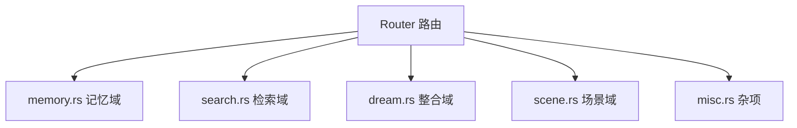

# MemRec 代码审查报告核实与 TODO 排定

**核实日期**：2026-10-18
**核实对象**：`docs/review/code-review-20261018-001-rust.md`
**核实方式**：源码逐行比对（codegraph + ripgrep + 直接读文件）+ `cargo clippy --release --all-targets` 实测 + 行数实测
**基线提交**：`796f74c docs: add full code review report for memrec project`（分支 `dev`）

---

## 一、核实结论总览

对报告 7 项中等问题、12 项低等问题逐条核实，结论如下：

| 结论 | 数量 | 条目 |
|------|------|------|
| 属实 | 12 | M-1、M-2、M-3（建议需修正）、M-5、M-6、M-7、L-2、L-3、L-4、L-6、L-8（含 L-11 重复）、L-9、L-10（严重低估） |
| 部分属实/需修正 | 4 | M-3、L-1、L-7、L-12 |
| 位置或描述有误 | 2 | L-5（文件错）、M-4（结论被夸大） |
| 重复条目 | 1 | L-11 与 L-8 同指 `traits.rs:197` |

报告**未覆盖**的实测问题：

- 基线声明“`cargo clippy --release --all-targets` 全绿”**不成立**。实测 `--all-targets` 产生 **39** 条告警，仅 lib（`cargo clippy --release`）也有 **9** 条告警。报告仅列了其中 3 条（L-1/L-2/L-3）。
- 大文件拆分维度报告完全未涉及（本次重点，见第四节）。

---

## 二、逐条核实明细

### 中等级（Medium）

| 编号 | 核实结论 | 实测位置 | 说明 |
|------|----------|----------|------|
| M-1 | 属实 | `memrecd/src/server/handler.rs:961-982` | 循环内逐条 `storage.get()`，N+1 成立。`SearchHit.payload` 已含 `content_preview/project_id/tags/chunk_*`，仅 `memory_type`、`created_at` 需回表 |
| M-2 | 属实 | `memrecd/src/server/handler.rs:1032-1038` | 图扩散命中逐条 `storage.get()`，N+1 成立 |
| M-3 | 部分属实，建议需修正 | `memrecd/src/daemon/mod.rs:315-330` | 逐条 `embed` 属实；但 `EmbeddingGenerator::embed_batch` **已存在**（`mr-ability/src/embedding/mod.rs:26`），故修复动作是“改用 embed_batch”而非“新增接口” |
| M-4 | 结论被夸大 | `mr-ability/src/storage/tantivy_store.rs:298-316` | `add`/`remove` 取写锁属实，但 `search`（`:318-332`）只调 `self.reader.searcher()`，**不获取该锁**，因此“写锁阻塞读者”不成立。实际风险仅为多次 `commit()` 的写放大，等级应下调 |
| M-5 | 属实 | `mr-ability/src/storage/rocksdb_vector.rs:186-232` | 全量遍历期间持 `cache` 互斥锁，且 `:219` 排序用 `partial_cmp(...).unwrap()`（NaN 会 panic） |
| M-6 | 属实 | `mr-ability/src/edge/generator.rs:218-237` | `parse_relations` 用 `unwrap_or_default()` 静默吞掉解析失败 |
| M-7 | 属实 | `memrecd/src/server/handler.rs:869-870` | `storage_usage`、`avg_importance` 硬编码 0.0；字段定义见 `mr-protocol/src/response.rs:267,269` |

### 低等级（Low）

| 编号 | 核实结论 | 实测位置 | 说明 |
|------|----------|----------|------|
| L-1 | 属实，但仅在测试代码 | `mr-common/src/types/llm.rs:363`（另 355/316/327/337/346 等） | `field_reassign_with_default`。全部命中都在 `#[cfg(test)]`；仅列一条不全 |
| L-2 | 属实 | `memrecd/src/server/handler.rs:340` | clippy `doc_lazy_continuation` 已复现 |
| L-3 | 属实 | `memrec/src/mcp/mod.rs:486` | clippy `redundant_closure` 已复现 |
| L-4 | 属实 | `mr-ability/src/llm/client.rs:97` | `.expect("failed to build HTTP client")` |
| L-5 | **文件位置错误** | 实为 `memrecd/src/config.rs:69`、`:121` | `memrecd/src/main.rs:121` 与 `home_dir` 无关。问题本身成立（两处 `.expect`），引用文件需更正 |
| L-6 | 属实 | `mr-ability/src/storage/tantivy_store.rs:346` | 软删/脏数据时会静默得到 nil Uuid |
| L-7 | 部分属实，需扩展 | `hybrid_store.rs:143` 属实；`mmr.rs:73` 错误 | `mmr.rs` 实际 NaN 风险在 `:64` 的 `.partial_cmp(b).unwrap()`（NaN 直接 panic，比报告描述更严重）；另 `rocksdb_vector.rs:219`、`processor.rs:623` 同类 |
| L-8 | 属实 | `mr-ability/src/storage/traits.rs:197` | `///////` 多斜杠 |
| L-9 | 属实 | `handler.rs:995`、`handler.rs:1017` | 内联 FQN；全库 `std::collections::(HashMap\|HashSet)` 内联共 37 处 |
| L-10 | 属实，**严重低估** | `mr-ability/src/dream/processor.rs:562-998` | `process_inner` 实测 **约 437 行**（非报告所称约 130 行），为全库最长函数 |
| L-11 | 与 L-8 重复 | 同 `traits.rs:197` | 建议合并 |
| L-12 | 部分属实 | `memrecd/src/server/handler.rs:1931,2003` 等 | 图扩散**已有**测试（含 quota 保留名额用例如 `test_search_graph_quota_reserves_slot`）；`propagation/engine.rs` 也有测试。缺口仅在 `edge_hint` 标注、软删过滤等分支，非“缺少测试” |

---

## 三、报告勘误汇总

1. 基线声明“clippy 全绿”错误：`--all-targets` 实测 39 条告警，lib 实测 9 条告警。
2. L-5 文件引用错误：应在 `memrecd/src/config.rs:69,121`。
3. L-7 `mmr.rs:73` 位置错误：应在 `mmr.rs:64`，且为 `unwrap()`（panic）而非 `unwrap_or(Equal)`。
4. L-10 函数长度低估：`process_inner` 约 437 行而非约 130 行。
5. L-11 与 L-8 重复。
6. L-12 描述不准确：图扩散、传播引擎均已有测试。
7. M-4 结论夸大：`search` 不持写锁，不存在“写锁阻塞读者”。
8. M-3 建议过时：`embed_batch` 已存在。
9. 报告遗漏 clippy lib 层其余 6 条告警（见下表）。

### 报告遗漏的 clippy 告警（lib 层实测）

| 位置 | 检查项 | 说明 |
|------|--------|------|
| `mr-common/src/types/dream_run.rs:68,88` | `derivable_impls` | impl 可派生 |
| `mr-common/src/types/llm.rs:175` | `question_mark` | 可用 `?` 运算符 |
| `mr-ability/src/dream/fusion.rs:156` | `sort_by_key` | 建议改 `sort_by_key` |
| `mr-ability/src/storage/dream_run_store.rs:83` | `sort_by_key` | 同上 |
| `mr-ability/src/storage/tantivy_store.rs:351` | `map_or` 可简化 | — |
| `mr-ability/src/storage/traits.rs:99` | `map_or` 可简化 | — |
| `mr-ability/src/dream/networking.rs:389,401` | `unnecessary_to_owned` | 多余 clone/切片 |
| `mr-ability/src/edge/generator.rs:434` | `unnecessary_to_owned` | 多余 clone |
| `mr-ability/src/storage/memory_store.rs:726` | `needless_borrow` | 多余借用 |
| `mr-ability/src/embedding/fastembed.rs`、`llm/client.rs` 测试 | `field_reassign_with_default` | 测试代码 |
| `mr-common/src/types/llm.rs` 测试 | `field_reassign_with_default` | 测试代码 |

---

## 四、大文件拆分 TODO（重点）

政策：**超 500 行应拆，超 1000 行必须拆**。以下先区分“生产代码行数”与“内联测试行数”，因为多数文件的膨胀来自 `#[cfg(test)] mod tests`。

### 4.1 实测行数分布

| 文件 | 总行数 | 生产行 | 测试行 | 判定 |
|------|--------|--------|--------|------|
| `memrecd/src/server/handler.rs` | 2679 | 1737 | 942 | 必须拆（生产+测试均超标） |
| `mr-ability/src/dream/processor.rs` | 1635 | 1155 | 480 | 必须拆（生产超标） |
| `memrec/src/mcp/mod.rs` | 931 | 744 | 187 | 应拆 |
| `mr-ability/tests/hybrid_search_integration.rs` | 901 | — | 901 | 应拆（纯集成测试） |
| `mr-ability/src/storage/memory_store.rs` | 863 | 594 | 269 | 应拆 |
| `mr-protocol/src/request.rs` | 692 | 549 | 143 | 应拆 |
| `memrec/src/commands/memory.rs` | 618 | 580 | 38 | 应拆 |
| `mr-ability/src/storage/tantivy_store.rs` | 581 | 431 | 150 | 仅测试超标，抽离测试即可 |
| `mr-ability/src/edge/generator.rs` | 562 | 404 | 158 | 仅测试超标，抽离测试即可 |
| `mr-common/src/types/config.rs` | 962 | 680 | 282 | 应拆（生产超标） |
| `mr-ability/src/tiered/engine.rs` | 528 | 217 | 311 | 仅测试超标，抽离测试即可 |

### 4.2 必须拆分：`memrecd/src/server/handler.rs`

按 RPC 领域拆为子模块 `memrecd/src/server/handler/`：

| 目标文件 | 迁入内容 |
|----------|----------|
| `handler/mod.rs` | `Router` 结构、`new/with_dream_run_store/with_edge_store/with_retrieval_graph/new_simple`、`route`、`parse_request`、`serialize_response` |
| `handler/memory.rs` | `handle_add`、`build_add_memory`、`apply_dedup_decision`、`merge_update_in_window`、`mark_superseded`、`save_and_index`、`build_payload`、`check_dedup`、`handle_get`、`handle_get_with_merge`、`handle_list`、`handle_delete`、`handle_restore`、`handle_stats` |
| `handler/search.rs` | `handle_search_memory`、`handle_tiered_search`、`build_tiered_result`、`generate_tier_content`（并将 M-1/M-2 的批量取数就地修复） |
| `handler/dream.rs` | `handle_dream`、`handle_dream_report` |
| `handler/scene.rs` | `handle_scene_create/get/list/delete/add_memory/remove_memory/update_heat` |
| `handler/misc.rs` | `handle_project_info`、`handle_version` |
| `handler/tests/`（或 `tests/`） | 942 行测试按域拆分 |

同时：**`handle_search_memory` 本身过长**（`:889-1139`，约 250 行），应下抽 `collect_seed_hits`、`expand_graph_hits`、`merge_with_graph_quota` 三个私有方法。

### 4.3 必须拆分：`mr-ability/src/dream/processor.rs`

| 目标文件 | 迁入内容 |
|----------|----------|
| `dream/processor/mod.rs` | `DreamProcessor` 结构、`new/with_*`、`execute`、`execute_ext`、`record_run` |
| `dream/processor/pipeline.rs` | `process_inner`（拆解，见下） |
| `dream/processor/helpers.rs` | `cosine_similarity`、`clean_summary`、`extract_summary_clues`、`build_produced_memory`、`parse_memory_type`、`gate_outcome`、`count_new_user_memories` |
| `dream/processor/metrics.rs` | `compute_metrics`、`run_phases`、`collect_embeddings`、`collect_integrated_source_ids`、`DreamResult` 及其 impl |
| `dream/processor/tests.rs` | 480 行测试 |

`process_inner`（437 行）拆解为：

- `select_candidates`（候选筛选与保留策略）
- `purge_integrated_sources`（幂等补删）
- `stage_f_fuse`（聚类 + 分簇提炼）
- `stage_n_network`（产出写入 + 建边 + 传播）
- `finalize_run`（统计与审计）

### 4.4 应拆文件

| 文件 | 拆分建议 |
|------|----------|
| `mr-common/src/types/config.rs` | 按配置域拆 `config/{memory,search,server,dream,llm}.rs` + `mod.rs` 汇总 |
| `memrec/src/mcp/mod.rs` | 拆 `mcp/{protocol,tools,resources}.rs`；`tool_*` 归 `tools.rs` |
| `mr-ability/src/storage/memory_store.rs` | 拆 `memory_store/{crud,index,migration}.rs` |
| `mr-protocol/src/request.rs` | 按请求域拆（记忆/场景/项目/配置） |
| `memrec/src/commands/memory.rs` | 生产 580 行接近阈值，可先抽 `chunk.rs`（切分与标签逻辑） |
| `mr-ability/tests/hybrid_search_integration.rs` | 按主题拆 `hybrid_search_*.rs` 多个集成测试文件 |

### 4.5 仅测试超标（抽离内联测试即可）

| 文件 | 动作 |
|------|------|
| `mr-ability/src/storage/tantivy_store.rs` | 测试抽至 `tests/` 或独立 `#[path]` 测试模块 |
| `mr-ability/src/edge/generator.rs` | 同上 |
| `mr-ability/src/tiered/engine.rs` | 同上（测试 311 行大于生产 217 行） |

---

## 五、TODO 排定

排序依据：正确性风险 > 检索质量影响 > 性能 > 规范。带 `[SPLIT]` 为拆分任务。

### P0 — 正确性/一致性（先做）

- [ ] **T-01**：`stats` 真实计算 `storage_usage`/`avg_importance`，或移除字段（M-7，`handler.rs:869`）
- [ ] **T-02**：`parse_relations` 静默失败加 `tracing::warn!`（M-6，`generator.rs:236`）
- [ ] **T-03**：修正 `partial_cmp().unwrap()` 的 NaN panic 与 `unwrap_or(Equal)` 的 NaN 歧义（L-7 扩展：`mmr.rs:64`、`rocksdb_vector.rs:219`、`hybrid_store.rs:143`、`processor.rs:623`）
- [ ] **T-04**：`Uuid::parse_str(...).unwrap_or_default()` 加调试日志（L-6，`tantivy_store.rs:346`）

### P1 — 性能（检索链路）

- [ ] **T-05**：新增 `MemoryStorage::get_many(&[Uuid])`，消除搜索与图扩散 N+1（M-1、M-2，`handler.rs:961`、`handler.rs:1032`）
- [ ] **T-06**：`rebuild_missing_embeddings` 改用 `embed_batch`（M-3，`daemon/mod.rs:315`）
- [ ] **T-07**：收窄 `RocksDBVectorStore::search` 持锁范围（M-5，`rocksdb_vector.rs:186-232`）

### P2 — 大文件拆分（本报告重点）

- [ ] **T-08 [SPLIT]**：拆 `memrecd/src/server/handler.rs`（2679 → 6 子模块 + 测试目录），并顺带下抽 `handle_search_memory`（详第四节 4.2）
- [ ] **T-09 [SPLIT]**：拆 `mr-ability/src/dream/processor.rs`（1635 → 5 子模块），并拆解 `process_inner`（437 行 → 5 函数）（详第四节 4.3）
- [ ] **T-10 [SPLIT]**：拆 `memrec/src/mcp/mod.rs`（931）、`config.rs`（962）、`memory_store.rs`（863）、`request.rs`（692）、`commands/memory.rs`（618）（详第四节 4.4）
- [ ] **T-11 [SPLIT]**：抽离 `tantivy_store.rs`、`generator.rs`、`tiered/engine.rs`、`hybrid_search_integration.rs` 的内联测试（详第四节 4.5）

### P3 — 规范/clippy 归零

- [ ] **T-12**：修复全部 clippy 告警（`--all-targets` 39 条，含报告遗漏 6 条 lib 告警），使 `cargo clippy --release --all-targets` 真正全绿
- [ ] **T-13**：移除生产代码 `expect`：`client.rs:97`（L-4）、`config.rs:69,121`（L-5 更正后位置）
- [ ] **T-14**：修正 `traits.rs:197` 多斜杠注释（L-8/L-11 合并）
- [ ] **T-15**：内联 FQN 改短名 `use`（L-9，全库 37 处）

### P4 — 测试补强

- [ ] **T-16**：补图扩散 `edge_hint` 标注与软删过滤分支测试（L-12 修正后范围，`handler.rs`）
- [ ] **T-17**：评估 `tantivy_store` 写入批量提交以降低 `commit()` 写放大（M-4 降级后重估）

---

## 六、验收要求

1. 每个 TODO 完成后：`cargo build --release`、`cargo test --release`、`cargo clippy --release --all-targets` 全绿。
2. 任何涉及检索、分词、向量、MMR、排序或存储索引的改动（T-03、T-05、T-07、T-08 中的 search 域），**必须**通过 `bash scripts/retrieval_gate.sh`（退出码 0）。
3. 拆分任务（T-08~T-11）为**纯结构搬迁**，不得改变行为；拆分前后测试集与门禁结果须一致。
4. 拆分后单文件生产代码须 ≤ 500 行（超 1000 行者强制拆分为硬性要求）。

---

## 七、执行结果（2026-10-18 完成）

全部 TODO 已执行完毕，逐项状态如下：

| 任务 | 状态 | 说明 |
|------|------|------|
| T-01 stats 去虚假精度 | 完成 | 移除 `storage_usage`/`avg_importance` 字段 |
| T-02 parse_relations 日志 | 完成 | 解析失败 `tracing::warn!`（含字符安全截断） |
| T-03 NaN 比较 | 完成 | `mmr.rs`/`rocksdb_vector.rs` 消除 `partial_cmp().unwrap()` panic |
| T-04 UUID 解析日志 | 完成 | `tantivy_store` 退化为 nil 前记录 debug |
| T-05 get_many 批量 | 完成 | 新增 `MemoryStorage::get_many` + `RocksDBStore::multi_get_cf`；搜索与图扩散消除 N+1 |
| T-06 embed_batch | 完成 | `rebuild_missing_embeddings` 改用 `embed_batch` |
| T-07 收窄向量搜索锁 | 完成 | 排序移出锁外，两段式持锁 |
| T-08 拆 handler.rs | 完成 | → `handler/{mod,memory_write,memory_read,search,dream,scene}` + `tests/` |
| T-09 拆 processor.rs + process_inner | 完成 | → `processor/{mod,helpers,pipeline,metrics,network,tests}`；`process_inner` 拆为 4 阶段方法 |
| T-10 拆 config/request/mcp/memory_store/commands | 完成 | 全部转为目录模块 |
| T-11 抽离内联测试 | 完成 | tantivy_store/generator/tiered engine + 集成测试拆分 |
| T-12 clippy 归零 | 完成 | `cargo clippy --release --all-targets` 0 告警 |
| T-13 移除 expect | 完成 | `client.rs` 返回 `Result`；`config.rs` 回退日志；`rocksdb_vector` 用 `context` |
| T-14 注释修正 | 完成 | `traits.rs` `///////` → `///` |
| T-15 FQN 修正 | 完成 | 全部内联 `std::collections::` 改为 `use` 短名 |
| T-16 图扩散测试补强 | 完成 | 新增软删邻居过滤测试；`edge_hint` 已有覆盖 |
| T-17 tantivy 写入批量评估 | 完成（不改动） | 结论见下 |

**T-17 评估结论**：`TantivyStore` 已提供 `add_many`（单次提交）并用于全文索引全量重建；单条记忆写入走 `add`（每次一提交）。结合 M-4 已降级（`search` 不持写锁，写不阻塞读者），当前写入量级（单次用户写入 + Dream 少量产出）不构成瓶颈，无需引入通道式写入。仅当写吞吐成为瓶颈时再复议。

**文件规模**：拆分后全部 `.rs` 文件生产代码 ≤ 500 行（`fd -e rs | xargs wc -l` 无 >500 项）。

**回归验证**：`cargo build --release`、`cargo test --release --workspace`、`cargo clippy --release --all-targets` 全部通过。

---

## 八、结论

报告整体方向正确，7 项中等问题中 5 项完全属实、1 项建议过时（M-3）、1 项结论夸大（M-4）；低等级问题存在 2 处位置错误（L-5、L-7）、1 处重复（L-11）、1 处描述失真（L-12）、1 处严重低估（L-10）。报告的“clippy 全绿”“图扩散测试缺失”等基线判断与实测不符，需以本核实为准。

最主要的工作量为**大文件拆分**：2 个文件必须拆（`handler.rs` 2679、`processor.rs` 1635），另有 6 个文件应拆、3 个文件仅需抽离测试。上述工作已按 P0 → P4 全部完成，拆分任务与检索质量门禁绑定验收。
